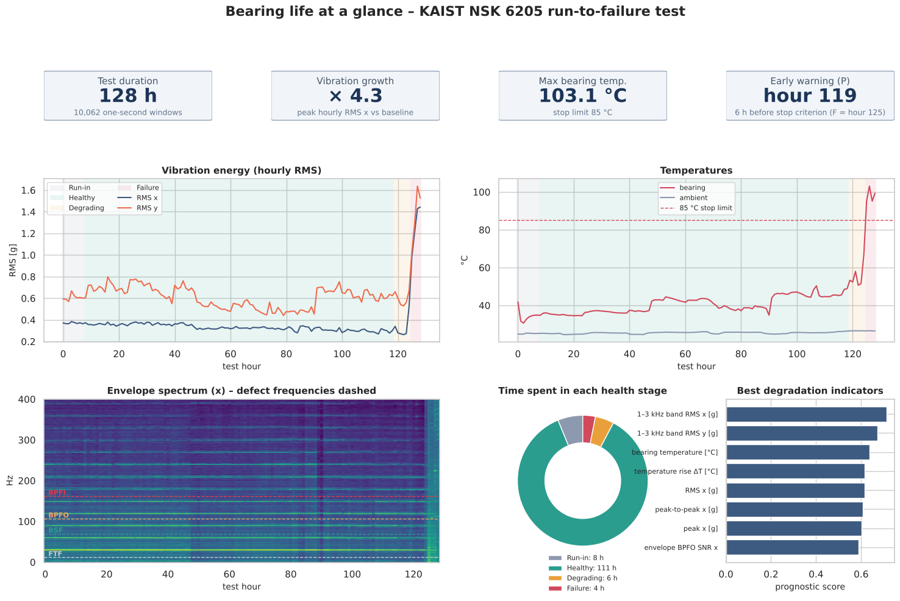
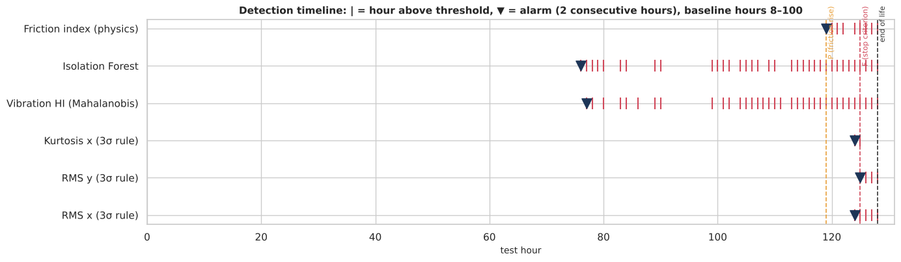

# Early-Stage Bearing Failure Prediction and RUL Estimation

**ISE 518 – Data Analytics for Reliability and Maintenance** · King Fahd University of Petroleum & Minerals · First Semester 2026-27
**Instructor:** Dr. Alaa Khamis · **Group 8**

| Member | Student ID |
|---|---|
| Mohammed Alsulami | 202612840 |
| Bassam Alawam | 202612700 |
| Nasser Alasmari | 201765530 |
| Mohammad Almarhoon | 201914630 |

| Notebook | Interactive dashboard |
|---|---|
| [](https://colab.research.google.com/github/Bassam724/ISE518-Bearing-RUL/blob/main/ISE518_G8_Bearing_EDA_RUL.ipynb) | [View dashboard](https://htmlpreview.github.io/?https://github.com/Bassam724/ISE518-Bearing-RUL/blob/main/dashboard/bearing_dashboard.html) |

The notebook follows the course's **7-step procedure**: problem characterization, data collection, data preparation,
data exploration (the full EDA of the assignment brief), model development, model evaluation and deployment.
Open it in Colab and choose *Runtime → Run all* (about 3–4 minutes). All data is loaded from this repository by URL.



## Main results
| Question | Answer from the data |
|---|---|
| When does degradation become detectable? | **Hour 119**: 6 h before the stop criterion was met (hour 125), 9 h before the end of the test, with no false alarms in 111 healthy hours |
| Which signals reveal it first? | The **temperature rise above ambient** and the **drop in shaft speed** (estimated from the vibration spectrum) – both consequences of friction. Vibration RMS stays flat until hour 124. |
| How well can RUL be estimated? | Mean absolute error ≈ **2.5 h over the last 12 h** when the failure path is represented in training (ridge regression on physics inputs, vs 6 h for a naive baseline). For a never-seen failure no model beats the baseline by much, which shows the need for more run-to-failure data. |
| Health-state classification Ŷ(t) = f(X(t)) | Logistic regression on the two physics inputs: **F1 = 0.72, ROC-AUC = 0.97** even when the failure stage is held out of training |



## Repository structure
```
ISE518_G8_Bearing_EDA_RUL.ipynb      main notebook (EDA + early detection + RUL)
data/processed/                      aggregated tables produced from the raw data (loaded by the notebook)
  window_features.csv.gz             10,062 one-second windows x 64 condition indicators
  file_quality_report.csv            data-quality checks for each of the 129 raw files
  file_metadata.csv                  file names, timestamps, estimated shaft speed
  psd_hourly.csv.gz                  power spectral density per hour and axis
  envelope_spectra_hourly.csv.gz     envelope spectrum per hour and axis
  raw_excerpts.csv.gz                first second of raw signal for 18 selected hours
  manifest.json, build_log.txt       parameters, versions and log of the pipeline run
pipeline/build_features.py           raw-data pipeline (download, validation, aggregation)
.github/workflows/build-features.yml GitHub Actions job that ran the pipeline on the 18.5 GB raw dataset
dashboard/bearing_dashboard.html     interactive Plotly dashboard generated by the notebook
docs/figures/                        figures used in this README
```

## Data
**Ball Bearing Vibration and Temperature Run-to-Failure Dataset** (KAIST): an NSK 6205 ball bearing run to failure under
2.94 kN axial and 5.88 kN radial load at ~1780 rpm. 129 hourly files, each 78.125 s at 25.6 kHz with x/y vibration,
bearing temperature and ambient temperature (18.5 GB in total).

* W. Jung, S.-H. Yun, Y.-H. Park, *Data in Brief* 54 (2024) 110403, doi:10.1016/j.dib.2024.110403
* Mendeley Data, doi:10.17632/5hcdd3tdvb.6, licensed CC BY 4.0

The raw files are not stored here. `pipeline/build_features.py` downloads them from Mendeley Data, checks their quality
and aggregates every 1-second window into time-domain, frequency-domain and envelope (bearing-defect) indicators.
The workflow in `.github/workflows/build-features.yml` ran it on GitHub's servers (about 9 minutes). To rebuild locally:

```bash
pip install numpy pandas scipy requests
python pipeline/build_features.py --download --out data/processed
```

## Running the notebook locally
```bash
pip install -r requirements.txt
jupyter notebook ISE518_G8_Bearing_EDA_RUL.ipynb
```

## AI use
In line with the course guidance on generative AI, the group discloses that Claude (Anthropic) assisted with the pipeline
code, the analysis and plotting code, the dashboard and first drafts of the explanations. All results are produced by
running the code on the real dataset. See the *AI use and reflection* section at the end of the notebook.
